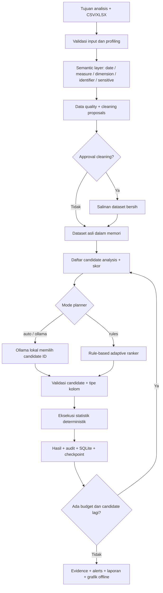

# Panduan Lengkap: Autonomous AI Data Analytics Lokal

## A. Apa yang sudah diimplementasikan?

Pipeline berjalan di komputer lokal dengan pendekatan **AI sebagai pengambil keputusan terbatas**, bukan AI yang diberi hak menjalankan kode Python sembarang. Setelah data dibaca dan diprofilkan, Python membangun daftar analisis yang relevan; agent memilih analisis, executor menghitung hasilnya, dan hasil tersebut dipakai pada langkah berikutnya.



## B. Langkah instalasi di Windows

1. Instal **Python 3.11 atau 3.12**.
2. Ekstrak ZIP, lalu buka foldernya dengan VS Code.
3. Jalankan terminal PowerShell berikut:

```powershell
py -3.11 -m venv .venv
.\.venv\Scripts\Activate.ps1
python -m pip install -r requirements.txt
python main.py run --mode rules
```

Untuk mengaktifkan AI planner (LLM), pasang Ollama dan modelnya:

```powershell
ollama pull qwen2.5:7b
python main.py run --mode auto
```

Ollama tidak wajib. Bila belum punya spesifikasi hardware yang cukup, gunakan mode `rules` terlebih dahulu.

## C. Tampilan antarmuka grafis

```powershell
pip install -r requirements-ui.txt
streamlit run app.py --server.address 127.0.0.1
```

Di browser, pengguna dapat mengunggah file, menentukan goal, memilih mode AI, menjalankan analisis, memeriksa audit dan insight, mengunduh HTML report, dan menyetujui cleaning yang diusulkan. Semua data tersimpan lokal. Untuk dashboard interaktif tanpa Internet, ekstrak hasil ZIP yang diunduh dari UI dan buka `report.html`.

## D. Menggunakan dataset sendiri

Masukkan file ke direktori `data/`, lalu jalankan:

```powershell
python main.py run --input data/penjualan.csv --goal "Cari tren omzet bulanan, kontribusi produk, dan data bermasalah" --mode auto --max-steps 15
```

Tidak perlu mengganti nama kolom. Namun, jika pendeteksian semantic layer salah, sunting `semantic_overrides` pada `config.json`:

```json
"semantic_overrides": {
  "tgl_transaksi": "date",
  "kategori_produk": "dimension",
  "nilai_transaksi": "measure",
  "kode_pesanan": "identifier"
}
```

Gunakan peran `sensitive` untuk kolom yang tidak boleh menjadi dasar pengelompokan otomatis.

## E. Menambah metrik bisnis

Untuk dataset yang menyimpan `quantity` dan `unit_price`, atur:

```json
"derived_metrics": {
  "estimated_revenue": {"multiply": ["quantity", "unit_price"]}
}
```

Ini bukan eksekusi formula bebas; executor hanya mengenal perkalian dua kolom numerik. Pastikan *estimated_revenue* sesuai definisi bisnis sebelum dipakai sebagai KPI.

## F. Cleaning dengan persetujuan

Default pipeline hanya **mengusulkan** cleaning. Setelah satu run selesai, periksa `outputs/<RUN_ID>/cleaning_proposals.json`. Contoh:

```json
{
  "id": "<hash_id>",
  "operation": "fill_median",
  "column": "unit_price",
  "affected_rows": 21,
  "explanation": "Fill numeric missing cells with the median; this may bias downstream statistics."
}
```

Jika setuju, jalankan:

```powershell
python main.py approve --run-id <RUN_ID> --all
python main.py run --approval-file outputs/<RUN_ID>/approvals.json
```

Anda dapat menyetujui ID tertentu melalui `--ids` untuk menghindari perubahan yang tidak diinginkan. Pipeline memverifikasi SHA256 file sumber dan proposal sebelum membuat dataset baru. File sumber tidak ditimpa.

## G. Prinsip autonomous decision making

### Observe

Agent membaca metadata: nama kolom, role, jumlah data hilang, jumlah observasi, dan ringkasan langkah sebelumnya. **Tidak mengirim baris mentah** ke LLM secara default.

### Generate candidates

Engine deterministik menyiapkan daftar analisis yang sesuai: agregasi total, rata-rata grup, analisis kontribusi, tren, perubahan bulanan, korelasi, dan IQR outlier.

### Plan

Mode `rules` mengambil kandidat dengan ranking tertinggi. Mode `ollama` meminta model lokal memilih *ID kandidat*, bukan mengarang kode/SQL sendiri. Contohnya:

```json
{"candidate_id": "c001", "reason": "Monthly revenue trend is relevant to the user's goal"}
```

### Execute

Python memvalidasi ID, nama kolom, dan peran kolom. Executor menghitung hasil dengan pandas dan menyimpan seluruh rekam keputusan. Operasi tidak aman atau tidak cocok ditolak.

### Reflect dan ulangi

Setelah analisis bulanan dilakukan, analisis `monthly_change` menjadi kandidat baru. Analisis yang sudah dilakukan tidak diulang. Siklus berhenti saat `max_steps`, `max_seconds`, atau kandidat valid habis.

### Synthesize

`evidence.json` menyimpan pernyataan kuantitatif yang diturunkan dari hasil Python. Jika Ollama aktif, LLM boleh memberikan komentar dan ide tindak lanjut dengan merujuk ID evidence. Karena bahasa natural dapat berhalusinasi, komentar AI diberi label *draft* dan tidak menggantikan bukti kuantitatif.

## H. Checkpoint, memori, dan eksekusi terjadwal

Riwayat eksperimen tersimpan pada SQLite (`outputs/run_history.sqlite`). Setiap langkah disimpan ke `outputs/<RUN_ID>/state.json` menggunakan penulisan file atomik.

```powershell
python main.py history
python main.py run --resume <RUN_ID>
python main.py watch --interval-minutes 30
```

`watch` akan menghindari menjalankan file yang telah dianalisis dengan goal sama, dan mencoba melanjutkan checkpoint berstatus `running`. Untuk otomasi yang tetap aktif setelah komputer restart, daftarkan `watch --once` melalui Windows Task Scheduler (contoh ada di `scripts/schedule_windows_example.ps1`).

## I. Batasan yang wajib dipahami

- Korelasi **bukan** hubungan sebab-akibat; IQR outliers bukan otomatis data salah.
- Tren bulanan dapat bias bila bulan awal/akhir tidak lengkap.
- Dukungan saat ini fokus pada **satu tabel per run**, bukan ETL lintas database atau join multi-tabel.
- Prediksi forecasting, causal inference, SQL agent, dan *unrestricted code-editing agent* tidak diimplementasikan; tambahkan sebagai tool yang diuji dan divalidasi jika benar-benar diperlukan.
- Streaming data real-time tidak tersedia; `watch` bekerja dengan polling file lokal.
- UI Streamlit ditujukan untuk satu pengguna, tidak memiliki autentikasi atau keamanan jaringan publik.
- Evaluasi insight penting tetap perlu persetujuan manusia sebelum keputusan bisnis.

## J. Pengujian

```powershell
pip install pytest
python -m pytest -q
```

Tersedia pengujian untuk hak akses operasi, sumber file yang tak berubah, approval, penolakan URL Ollama eksternal, resume, dataset dengan nama kolom berbeda, fallback saat model offline, dan simulasi respons terstruktur dari planner.
